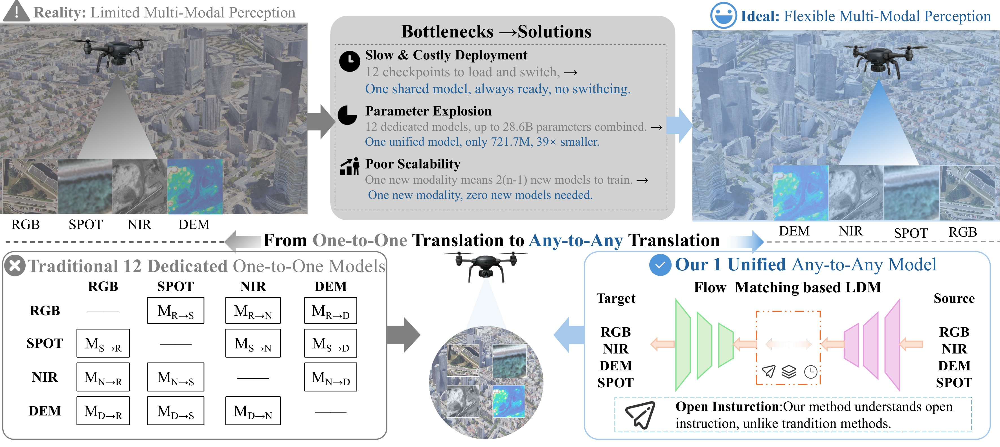
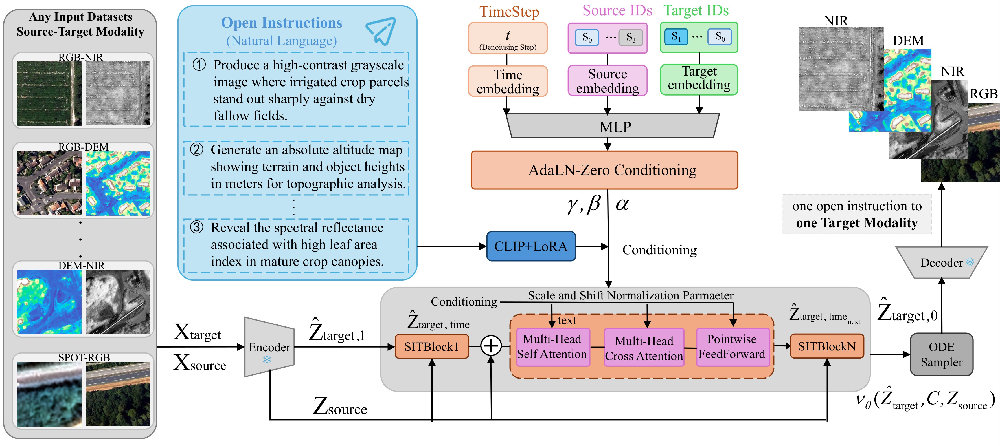
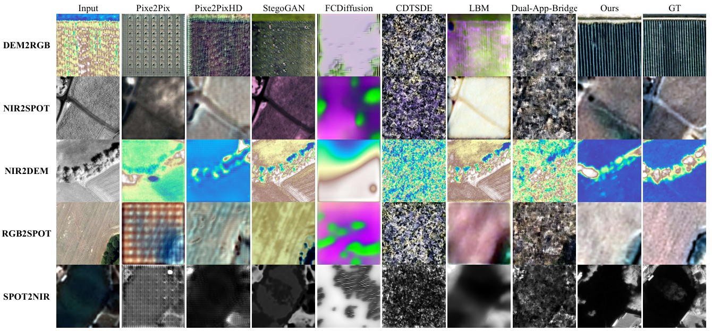

<div align="center">

# OIGA2A: Open Instruction Guided Any-to-Any Aerial Image Translation via a Single Flow Matching Model

**Anonymous Authors** | Under Review at IEEE TCSVT

> *A partial code release (data pipeline, instruction pool, intent router, and configs) is now available in this repository. The complete codebase will be released after the paper review is concluded — see [Code Release](#code-release).*

[]()
[]()
[]()

</div>

---

## Abstract

Pairwise aerial cross-modal translation requires a dedicated model for each source–target direction, leading to quadratic growth in model count and deployment overhead. To address this limitation, we propose Open Instruction Guided Any-to-Any (OIGA2A), a unified model that supports all 12 translation directions among RGB, near-infrared (NIR), digital elevation models (DEMs), and SPOT satellite imagery, guided by free-form natural-language instructions. The generator is a flow matching diffusion Transformer that operates in a shared latent space learned by a single jointly trained KL-regularized variational autoencoder. A dynamic loss mask router supplements pixel-wise reconstruction with perceptual supervision for optical imagery and spatial gradient constraints for elevation maps. A conditioning scheme integrates open instruction semantics via a LoRA-finetuned CLIP encoder and structural alignment via AdaLN-Zero modulation, with classifier-free guidance further enhancing inference controllability. Extensive experiments on all 12 translation directions show that this unified model outperforms seven pair-specific baselines in average FID, LPIPS, and SSIM, consolidating all directions into one deployable weight set and remaining robust to arbitrary expert phrasing. By unifying all mappings, OIGA2A replaces up to twelve per-direction checkpoints with one 721.7M-parameter model. This unified, instruction-driven paradigm offers a promising foundation for scalable multimodal image synthesis in UAV-based Earth observation and broader remote-sensing applications. Code is available at [github.com/RisingInsight/OIGA2A](https://github.com/RisingInsight/OIGA2A).

## Contributions

<div align="center">



*Qualitative comparison between traditional image translation methods and our method.*

</div>

The main contributions are summarized as follows:

- We propose **OIGA2A**, the first instruction guided any-to-any translation framework for UAV perception modalities. It collapses all 12 cross-modal pathways among RGB, NIR, DEM, and SPOT into a single network and eliminates quadratic model growth. OIGA2A can be extended to a new modality without adding new encoder, decoder, or backbone modules.
- We design a **Dynamic Loss Mask Router on a shared KL-regularized VAE latent space**. It routes photometric supervision (ℓ1 and LPIPS) to optical modalities and spatial gradient constraints to DEM, thereby preventing cross-modal gradient interference between photometric texture and topographic geometry.
- We develop a **Modality Calibrated Flow Matching backbone** and a **conditioning strategy**. The backbone learns continuous velocity fields along straight line interpolation paths with per-modality latent normalization and lightweight residual adapters. For conditioning, a LoRA-finetuned CLIP encoder injects open-vocabulary expert instructions via cross-attention, while AdaLN-Zero jointly modulates source modality, target modality, and timestep.
- On the FLAIR-HUB benchmark, the single OIGA2A model outperforms seven pairwise baselines on 12 translation tasks, reducing average FID by 14.7% and achieving lower LPIPS and higher SSIM. It is also far more compact, requiring only one-fortieth to one-third of the parameters of five of the seven baselines, while a fixed-step Euler solver cuts inference latency by nearly two-thirds.

---

## Method

<div align="center">



*Overview of the OIGA2A framework.*

</div>

---

## Results

### Comparison with Existing Methods

*Note: Our method employs a **single unified Any-to-Any model** for all 12 tasks, whereas all baseline methods require training **12 independent One-to-One models**.*

#### (a) Source Modality: DEM → ANY

<!-- 使用 HTML 表格并加宽 Method 列 -->

<table align="center" style="width: 110%; margin-left: -5% border-collapse: collapse; font-size: 14px;">
  <thead>
    <tr style="background: linear-gradient(135deg, #2980b9, #3498db); color: white;">
      <th rowspan="2" style="text-align: center; padding: 10px; min-width: 280px; border: 1px solid #2980b9;">Method</th>
      <th colspan="4" style="text-align: center; padding: 10px; border: 1px solid #2980b9;">DEM &rarr; NIR</th>
      <th colspan="4" style="text-align: center; padding: 10px; border: 1px solid #2980b9;">DEM &rarr; RGB</th>
      <th colspan="4" style="text-align: center; padding: 10px; border: 1px solid #2980b9;">DEM &rarr; SPOT</th>
    </tr>
    <tr style="background: linear-gradient(135deg, #2980b9, #3498db); color: white;">
      <th style="text-align: center; padding: 6px; border: 1px solid #2980b9;">FID&darr;</th><th style="text-align: center; padding: 6px; border: 1px solid #2980b9;">LPIPS&darr;</th><th style="text-align: center; padding: 6px; border: 1px solid #2980b9;">PSNR&uarr;</th><th style="text-align: center; padding: 6px; border: 1px solid #2980b9;">SSIM&uarr;</th>
      <th style="text-align: center; padding: 6px; border: 1px solid #2980b9;">FID&darr;</th><th style="text-align: center; padding: 6px; border: 1px solid #2980b9;">LPIPS&darr;</th><th style="text-align: center; padding: 6px; border: 1px solid #2980b9;">PSNR&uarr;</th><th style="text-align: center; padding: 6px; border: 1px solid #2980b9;">SSIM&uarr;</th>
      <th style="text-align: center; padding: 6px; border: 1px solid #2980b9;">FID&darr;</th><th style="text-align: center; padding: 6px; border: 1px solid #2980b9;">LPIPS&darr;</th><th style="text-align: center; padding: 6px; border: 1px solid #2980b9;">PSNR&uarr;</th><th style="text-align: center; padding: 6px; border: 1px solid #2980b9;">SSIM&uarr;</th>
    </tr>
  </thead>
  <tbody>
    <tr>
      <td style="text-align: center; padding: 8px; border-bottom: 1px solid #e0e6ed;">Pix2Pix (CVPR, 2017)</td>
      <td style="text-align: center; padding: 8px; border-bottom: 1px solid #e0e6ed;">367.1304</td><td style="text-align: center; padding: 8px; border-bottom: 1px solid #e0e6ed;">0.7081</td><td style="text-align: center; padding: 8px; border-bottom: 1px solid #e0e6ed;">13.6182</td><td style="text-align: center; padding: 8px; border-bottom: 1px solid #e0e6ed;">0.2387</td>
      <td style="text-align: center; padding: 8px; border-bottom: 1px solid #e0e6ed;">272.0429</td><td style="text-align: center; padding: 8px; border-bottom: 1px solid #e0e6ed;">0.7273</td><td style="text-align: center; padding: 8px; border-bottom: 1px solid #e0e6ed;"><b>14.3057</b></td><td style="text-align: center; padding: 8px; border-bottom: 1px solid #e0e6ed;">0.3532</td>
      <td style="text-align: center; padding: 8px; border-bottom: 1px solid #e0e6ed;">176.7447</td><td style="text-align: center; padding: 8px; border-bottom: 1px solid #e0e6ed;">0.1125</td><td style="text-align: center; padding: 8px; border-bottom: 1px solid #e0e6ed;">29.8107</td><td style="text-align: center; padding: 8px; border-bottom: 1px solid #e0e6ed;">0.8483</td>
    </tr>
    <tr style="background-color: #f7f9fc;">
      <td style="text-align: center; padding: 8px; border-bottom: 1px solid #e0e6ed;">Pix2PixHD (CVPR, 2018)</td>
      <td style="text-align: center; padding: 8px; border-bottom: 1px solid #e0e6ed;">281.2315</td><td style="text-align: center; padding: 8px; border-bottom: 1px solid #e0e6ed;"><u>0.6777</u></td><td style="text-align: center; padding: 8px; border-bottom: 1px solid #e0e6ed;">13.4883</td><td style="text-align: center; padding: 8px; border-bottom: 1px solid #e0e6ed;">0.3506</td>
      <td style="text-align: center; padding: 8px; border-bottom: 1px solid #e0e6ed;">287.3042</td><td style="text-align: center; padding: 8px; border-bottom: 1px solid #e0e6ed;">0.7109</td><td style="text-align: center; padding: 8px; border-bottom: 1px solid #e0e6ed;">13.6673</td><td style="text-align: center; padding: 8px; border-bottom: 1px solid #e0e6ed;">0.3729</td>
      <td style="text-align: center; padding: 8px; border-bottom: 1px solid #e0e6ed;"><u>119.9822</u></td><td style="text-align: center; padding: 8px; border-bottom: 1px solid #e0e6ed;"><b>0.0768</b></td><td style="text-align: center; padding: 8px; border-bottom: 1px solid #e0e6ed;"><b>32.2567</b></td><td style="text-align: center; padding: 8px; border-bottom: 1px solid #e0e6ed;"><b>0.9157</b></td>
    </tr>
    <tr>
      <td style="text-align: center; padding: 8px; border-bottom: 1px solid #e0e6ed;">StegoGAN (CVPR, 2024)</td>
      <td style="text-align: center; padding: 8px; border-bottom: 1px solid #e0e6ed;"><u>263.6834</u></td><td style="text-align: center; padding: 8px; border-bottom: 1px solid #e0e6ed;">0.7296</td><td style="text-align: center; padding: 8px; border-bottom: 1px solid #e0e6ed;">12.8863</td><td style="text-align: center; padding: 8px; border-bottom: 1px solid #e0e6ed;"><u>0.4589</u></td>
      <td style="text-align: center; padding: 8px; border-bottom: 1px solid #e0e6ed;"><u>271.8155</u></td><td style="text-align: center; padding: 8px; border-bottom: 1px solid #e0e6ed;">0.7988</td><td style="text-align: center; padding: 8px; border-bottom: 1px solid #e0e6ed;">11.3851</td><td style="text-align: center; padding: 8px; border-bottom: 1px solid #e0e6ed;">0.3649</td>
      <td style="text-align: center; padding: 8px; border-bottom: 1px solid #e0e6ed;">143.9765</td><td style="text-align: center; padding: 8px; border-bottom: 1px solid #e0e6ed;">0.1295</td><td style="text-align: center; padding: 8px; border-bottom: 1px solid #e0e6ed;">29.0394</td><td style="text-align: center; padding: 8px; border-bottom: 1px solid #e0e6ed;">0.8066</td>
    </tr>
    <tr style="background-color: #f7f9fc;">
      <td style="text-align: center; padding: 8px; border-bottom: 1px solid #e0e6ed;">FCDiffusion (AAAI, 2024)</td>
      <td style="text-align: center; padding: 8px; border-bottom: 1px solid #e0e6ed;">396.8576</td><td style="text-align: center; padding: 8px; border-bottom: 1px solid #e0e6ed;">0.9158</td><td style="text-align: center; padding: 8px; border-bottom: 1px solid #e0e6ed;">9.5075</td><td style="text-align: center; padding: 8px; border-bottom: 1px solid #e0e6ed;">0.2862</td>
      <td style="text-align: center; padding: 8px; border-bottom: 1px solid #e0e6ed;">340.8000</td><td style="text-align: center; padding: 8px; border-bottom: 1px solid #e0e6ed;">0.9860</td><td style="text-align: center; padding: 8px; border-bottom: 1px solid #e0e6ed;">9.5466</td><td style="text-align: center; padding: 8px; border-bottom: 1px solid #e0e6ed;">0.3492</td>
      <td style="text-align: center; padding: 8px; border-bottom: 1px solid #e0e6ed;">256.0318</td><td style="text-align: center; padding: 8px; border-bottom: 1px solid #e0e6ed;">0.5029</td><td style="text-align: center; padding: 8px; border-bottom: 1px solid #e0e6ed;">13.1507</td><td style="text-align: center; padding: 8px; border-bottom: 1px solid #e0e6ed;">0.5649</td>
    </tr>
    <tr>
      <td style="text-align: center; padding: 8px; border-bottom: 1px solid #e0e6ed;">CDTSDE (ICLR, 2026)</td>
      <td style="text-align: center; padding: 8px; border-bottom: 1px solid #e0e6ed;">440.6330</td><td style="text-align: center; padding: 8px; border-bottom: 1px solid #e0e6ed;">0.8625</td><td style="text-align: center; padding: 8px; border-bottom: 1px solid #e0e6ed;">11.5615</td><td style="text-align: center; padding: 8px; border-bottom: 1px solid #e0e6ed;">0.2663</td>
      <td style="text-align: center; padding: 8px; border-bottom: 1px solid #e0e6ed;">391.3203</td><td style="text-align: center; padding: 8px; border-bottom: 1px solid #e0e6ed;">0.7959</td><td style="text-align: center; padding: 8px; border-bottom: 1px solid #e0e6ed;">9.4740</td><td style="text-align: center; padding: 8px; border-bottom: 1px solid #e0e6ed;">0.1247</td>
      <td style="text-align: center; padding: 8px; border-bottom: 1px solid #e0e6ed;">335.5845</td><td style="text-align: center; padding: 8px; border-bottom: 1px solid #e0e6ed;">1.1253</td><td style="text-align: center; padding: 8px; border-bottom: 1px solid #e0e6ed;">4.6325</td><td style="text-align: center; padding: 8px; border-bottom: 1px solid #e0e6ed;">0.0582</td>
    </tr>
    <tr style="background-color: #f7f9fc;">
      <td style="text-align: center; padding: 8px; border-bottom: 1px solid #e0e6ed;">LBM (ICCV, 2025)</td>
      <td style="text-align: center; padding: 8px; border-bottom: 1px solid #e0e6ed;">355.8055</td><td style="text-align: center; padding: 8px; border-bottom: 1px solid #e0e6ed;">0.9036</td><td style="text-align: center; padding: 8px; border-bottom: 1px solid #e0e6ed;">12.1598</td><td style="text-align: center; padding: 8px; border-bottom: 1px solid #e0e6ed;"><b>0.4865</b></td>
      <td style="text-align: center; padding: 8px; border-bottom: 1px solid #e0e6ed;">327.1792</td><td style="text-align: center; padding: 8px; border-bottom: 1px solid #e0e6ed;">0.8987</td><td style="text-align: center; padding: 8px; border-bottom: 1px solid #e0e6ed;">13.5023</td><td style="text-align: center; padding: 8px; border-bottom: 1px solid #e0e6ed;"><b>0.5102</b></td>
      <td style="text-align: center; padding: 8px; border-bottom: 1px solid #e0e6ed;">301.4901</td><td style="text-align: center; padding: 8px; border-bottom: 1px solid #e0e6ed;">0.6673</td><td style="text-align: center; padding: 8px; border-bottom: 1px solid #e0e6ed;">9.2328</td><td style="text-align: center; padding: 8px; border-bottom: 1px solid #e0e6ed;">0.2866</td>
    </tr>
    <tr>
      <td style="text-align: center; padding: 8px; border-bottom: 1px solid #e0e6ed;">AppBridge (CVPR 2025)</td>
      <td style="text-align: center; padding: 8px; border-bottom: 1px solid #e0e6ed;">358.3385</td><td style="text-align: center; padding: 8px; border-bottom: 1px solid #e0e6ed;">0.7900</td><td style="text-align: center; padding: 8px; border-bottom: 1px solid #e0e6ed;">12.0918</td><td style="text-align: center; padding: 8px; border-bottom: 1px solid #e0e6ed;">0.3733</td>
      <td style="text-align: center; padding: 8px; border-bottom: 1px solid #e0e6ed;">321.8264</td><td style="text-align: center; padding: 8px; border-bottom: 1px solid #e0e6ed;">0.7889</td><td style="text-align: center; padding: 8px; border-bottom: 1px solid #e0e6ed;">12.9115</td><td style="text-align: center; padding: 8px; border-bottom: 1px solid #e0e6ed;"><u>0.4189</u></td>
      <td style="text-align: center; padding: 8px; border-bottom: 1px solid #e0e6ed;">307.8813</td><td style="text-align: center; padding: 8px; border-bottom: 1px solid #e0e6ed;">0.8493</td><td style="text-align: center; padding: 8px; border-bottom: 1px solid #e0e6ed;">7.5977</td><td style="text-align: center; padding: 8px; border-bottom: 1px solid #e0e6ed;">0.1818</td>
    </tr>
    <tr style="background-color: #dbeafe; font-weight: 600; border-left: 3px solid #2980b9;">
      <td style="text-align: center; padding: 8px; border-bottom: 1px solid #e0e6ed;"><b>Ours</b></td>
      <td style="text-align: center; padding: 8px; border-bottom: 1px solid #e0e6ed;"><b>258.8817</b></td><td style="text-align: center; padding: 8px; border-bottom: 1px solid #e0e6ed;"><b>0.5419</b></td><td style="text-align: center; padding: 8px; border-bottom: 1px solid #e0e6ed;"><b>14.6291</b></td><td style="text-align: center; padding: 8px; border-bottom: 1px solid #e0e6ed;">0.4027</td>
      <td style="text-align: center; padding: 8px; border-bottom: 1px solid #e0e6ed;"><b>228.8502</b></td><td style="text-align: center; padding: 8px; border-bottom: 1px solid #e0e6ed;"><b>0.6600</b></td><td style="text-align: center; padding: 8px; border-bottom: 1px solid #e0e6ed;">12.7016</td><td style="text-align: center; padding: 8px; border-bottom: 1px solid #e0e6ed;">0.3732</td>
      <td style="text-align: center; padding: 8px; border-bottom: 1px solid #e0e6ed;"><b>98.4160</b></td><td style="text-align: center; padding: 8px; border-bottom: 1px solid #e0e6ed;"><u>0.0991</u></td><td style="text-align: center; padding: 8px; border-bottom: 1px solid #e0e6ed;"><u>30.0675</u></td><td style="text-align: center; padding: 8px; border-bottom: 1px solid #e0e6ed;"><u>0.8771</u></td>
    </tr>
  </tbody>
</table>
<br>

#### (b) Source Modality: NIR → ANY

<table align="center" style="width: 100%; border-collapse: collapse; font-size: 14px;">
  <thead>
    <tr style="background: linear-gradient(135deg, #2980b9, #3498db); color: white;">
      <th rowspan="2" style="text-align: center; padding: 10px; min-width: 280px; border: 1px solid #2980b9;">Method</th>
      <th colspan="4" style="text-align: center; padding: 10px; border: 1px solid #2980b9;">NIR &rarr; DEM</th>
      <th colspan="4" style="text-align: center; padding: 10px; border: 1px solid #2980b9;">NIR &rarr; RGB</th>
      <th colspan="4" style="text-align: center; padding: 10px; border: 1px solid #2980b9;">NIR &rarr; SPOT</th>
    </tr>
    <tr style="background: linear-gradient(135deg, #2980b9, #3498db); color: white;">
      <th style="text-align: center; padding: 6px; border: 1px solid #2980b9;">FID&darr;</th><th style="text-align: center; padding: 6px; border: 1px solid #2980b9;">LPIPS&darr;</th><th style="text-align: center; padding: 6px; border: 1px solid #2980b9;">PSNR&uarr;</th><th style="text-align: center; padding: 6px; border: 1px solid #2980b9;">SSIM&uarr;</th>
      <th style="text-align: center; padding: 6px; border: 1px solid #2980b9;">FID&darr;</th><th style="text-align: center; padding: 6px; border: 1px solid #2980b9;">LPIPS&darr;</th><th style="text-align: center; padding: 6px; border: 1px solid #2980b9;">PSNR&uarr;</th><th style="text-align: center; padding: 6px; border: 1px solid #2980b9;">SSIM&uarr;</th>
      <th style="text-align: center; padding: 6px; border: 1px solid #2980b9;">FID&darr;</th><th style="text-align: center; padding: 6px; border: 1px solid #2980b9;">LPIPS&darr;</th><th style="text-align: center; padding: 6px; border: 1px solid #2980b9;">PSNR&uarr;</th><th style="text-align: center; padding: 6px; border: 1px solid #2980b9;">SSIM&uarr;</th>
    </tr>
  </thead>
  <tbody>
    <tr>
      <td style="text-align: center; padding: 8px; border-bottom: 1px solid #e0e6ed;">Pix2Pix (CVPR, 2017)</td>
      <td style="text-align: center; padding: 8px; border-bottom: 1px solid #e0e6ed;">217.7814</td><td style="text-align: center; padding: 8px; border-bottom: 1px solid #e0e6ed;">0.7055</td><td style="text-align: center; padding: 8px; border-bottom: 1px solid #e0e6ed;"><b>16.3526</b></td><td style="text-align: center; padding: 8px; border-bottom: 1px solid #e0e6ed;">0.6199</td>
      <td style="text-align: center; padding: 8px; border-bottom: 1px solid #e0e6ed;">293.9488</td><td style="text-align: center; padding: 8px; border-bottom: 1px solid #e0e6ed;">0.6554</td><td style="text-align: center; padding: 8px; border-bottom: 1px solid #e0e6ed;">13.9647</td><td style="text-align: center; padding: 8px; border-bottom: 1px solid #e0e6ed;">0.3528</td>
      <td style="text-align: center; padding: 8px; border-bottom: 1px solid #e0e6ed;">182.5380</td><td style="text-align: center; padding: 8px; border-bottom: 1px solid #e0e6ed;">0.3095</td><td style="text-align: center; padding: 8px; border-bottom: 1px solid #e0e6ed;">19.0610</td><td style="text-align: center; padding: 8px; border-bottom: 1px solid #e0e6ed;">0.6870</td>
    </tr>
    <tr style="background-color: #f7f9fc;">
      <td style="text-align: center; padding: 8px; border-bottom: 1px solid #e0e6ed;">Pix2PixHD (CVPR, 2018)</td>
      <td style="text-align: center; padding: 8px; border-bottom: 1px solid #e0e6ed;"><u>147.3903</u></td><td style="text-align: center; padding: 8px; border-bottom: 1px solid #e0e6ed;"><u>0.3944</u></td><td style="text-align: center; padding: 8px; border-bottom: 1px solid #e0e6ed;"><u>15.7957</u></td><td style="text-align: center; padding: 8px; border-bottom: 1px solid #e0e6ed;"><b>0.9270</b></td>
      <td style="text-align: center; padding: 8px; border-bottom: 1px solid #e0e6ed;">227.4111</td><td style="text-align: center; padding: 8px; border-bottom: 1px solid #e0e6ed;">0.6653</td><td style="text-align: center; padding: 8px; border-bottom: 1px solid #e0e6ed;">14.8828</td><td style="text-align: center; padding: 8px; border-bottom: 1px solid #e0e6ed;">0.4184</td>
      <td style="text-align: center; padding: 8px; border-bottom: 1px solid #e0e6ed;"><b>97.7339</b></td><td style="text-align: center; padding: 8px; border-bottom: 1px solid #e0e6ed;"><b>0.0768</b></td><td style="text-align: center; padding: 8px; border-bottom: 1px solid #e0e6ed;"><b>32.1554</b></td><td style="text-align: center; padding: 8px; border-bottom: 1px solid #e0e6ed;"><b>0.9164</b></td>
    </tr>
    <tr>
      <td style="text-align: center; padding: 8px; border-bottom: 1px solid #e0e6ed;">StegoGAN (CVPR, 2024)</td>
      <td style="text-align: center; padding: 8px; border-bottom: 1px solid #e0e6ed;">346.3830</td><td style="text-align: center; padding: 8px; border-bottom: 1px solid #e0e6ed;">0.9165</td><td style="text-align: center; padding: 8px; border-bottom: 1px solid #e0e6ed;">12.7144</td><td style="text-align: center; padding: 8px; border-bottom: 1px solid #e0e6ed;">0.5367</td>
      <td style="text-align: center; padding: 8px; border-bottom: 1px solid #e0e6ed;"><u>115.2302</u></td><td style="text-align: center; padding: 8px; border-bottom: 1px solid #e0e6ed;"><u>0.4161</u></td><td style="text-align: center; padding: 8px; border-bottom: 1px solid #e0e6ed;">14.0133</td><td style="text-align: center; padding: 8px; border-bottom: 1px solid #e0e6ed;"><u>0.6723</u></td>
      <td style="text-align: center; padding: 8px; border-bottom: 1px solid #e0e6ed;"><u>117.5049</u></td><td style="text-align: center; padding: 8px; border-bottom: 1px solid #e0e6ed;"><u>0.1084</u></td><td style="text-align: center; padding: 8px; border-bottom: 1px solid #e0e6ed;"><u>26.8914</u></td><td style="text-align: center; padding: 8px; border-bottom: 1px solid #e0e6ed;"><u>0.3696</u></td>
    </tr>
    <tr style="background-color: #f7f9fc;">
      <td style="text-align: center; padding: 8px; border-bottom: 1px solid #e0e6ed;">FCDiffusion (AAAI, 2024)</td>
      <td style="text-align: center; padding: 8px; border-bottom: 1px solid #e0e6ed;">220.4016</td><td style="text-align: center; padding: 8px; border-bottom: 1px solid #e0e6ed;">0.4984</td><td style="text-align: center; padding: 8px; border-bottom: 1px solid #e0e6ed;">10.2435</td><td style="text-align: center; padding: 8px; border-bottom: 1px solid #e0e6ed;">0.7326</td>
      <td style="text-align: center; padding: 8px; border-bottom: 1px solid #e0e6ed;">358.5142</td><td style="text-align: center; padding: 8px; border-bottom: 1px solid #e0e6ed;">0.9222</td><td style="text-align: center; padding: 8px; border-bottom: 1px solid #e0e6ed;">9.1056</td><td style="text-align: center; padding: 8px; border-bottom: 1px solid #e0e6ed;">0.3153</td>
      <td style="text-align: center; padding: 8px; border-bottom: 1px solid #e0e6ed;">244.1984</td><td style="text-align: center; padding: 8px; border-bottom: 1px solid #e0e6ed;">0.5488</td><td style="text-align: center; padding: 8px; border-bottom: 1px solid #e0e6ed;">10.9218</td><td style="text-align: center; padding: 8px; border-bottom: 1px solid #e0e6ed;">0.4064</td>
    </tr>
    <tr>
      <td style="text-align: center; padding: 8px; border-bottom: 1px solid #e0e6ed;">CDTSDE (ICLR, 2026)</td>
      <td style="text-align: center; padding: 8px; border-bottom: 1px solid #e0e6ed;">324.5986</td><td style="text-align: center; padding: 8px; border-bottom: 1px solid #e0e6ed;">1.0362</td><td style="text-align: center; padding: 8px; border-bottom: 1px solid #e0e6ed;">11.5687</td><td style="text-align: center; padding: 8px; border-bottom: 1px solid #e0e6ed;">0.2929</td>
      <td style="text-align: center; padding: 8px; border-bottom: 1px solid #e0e6ed;">372.1441</td><td style="text-align: center; padding: 8px; border-bottom: 1px solid #e0e6ed;">0.8467</td><td style="text-align: center; padding: 8px; border-bottom: 1px solid #e0e6ed;">8.0781</td><td style="text-align: center; padding: 8px; border-bottom: 1px solid #e0e6ed;">0.1728</td>
      <td style="text-align: center; padding: 8px; border-bottom: 1px solid #e0e6ed;">368.4434</td><td style="text-align: center; padding: 8px; border-bottom: 1px solid #e0e6ed;">1.1323</td><td style="text-align: center; padding: 8px; border-bottom: 1px solid #e0e6ed;">6.2722</td><td style="text-align: center; padding: 8px; border-bottom: 1px solid #e0e6ed;">0.0639</td>
    </tr>
    <tr style="background-color: #f7f9fc;">
      <td style="text-align: center; padding: 8px; border-bottom: 1px solid #e0e6ed;">LBM (ICCV, 2025)</td>
      <td style="text-align: center; padding: 8px; border-bottom: 1px solid #e0e6ed;">362.9729</td><td style="text-align: center; padding: 8px; border-bottom: 1px solid #e0e6ed;">0.9045</td><td style="text-align: center; padding: 8px; border-bottom: 1px solid #e0e6ed;">11.4484</td><td style="text-align: center; padding: 8px; border-bottom: 1px solid #e0e6ed;">0.5648</td>
      <td style="text-align: center; padding: 8px; border-bottom: 1px solid #e0e6ed;"><b>104.7898</b></td><td style="text-align: center; padding: 8px; border-bottom: 1px solid #e0e6ed;"><b>0.3423</b></td><td style="text-align: center; padding: 8px; border-bottom: 1px solid #e0e6ed;"><b>15.5496</b></td><td style="text-align: center; padding: 8px; border-bottom: 1px solid #e0e6ed;"><b>0.7128</b></td>
      <td style="text-align: center; padding: 8px; border-bottom: 1px solid #e0e6ed;">314.1208</td><td style="text-align: center; padding: 8px; border-bottom: 1px solid #e0e6ed;">0.8173</td><td style="text-align: center; padding: 8px; border-bottom: 1px solid #e0e6ed;">0.9629</td><td style="text-align: center; padding: 8px; border-bottom: 1px solid #e0e6ed;">0.0902</td>
    </tr>
    <tr>
      <td style="text-align: center; padding: 8px; border-bottom: 1px solid #e0e6ed;">AppBridge (CVPR 2025)</td>
      <td style="text-align: center; padding: 8px; border-bottom: 1px solid #e0e6ed;">295.8813</td><td style="text-align: center; padding: 8px; border-bottom: 1px solid #e0e6ed;">1.0167</td><td style="text-align: center; padding: 8px; border-bottom: 1px solid #e0e6ed;">12.4218</td><td style="text-align: center; padding: 8px; border-bottom: 1px solid #e0e6ed;">0.4318</td>
      <td style="text-align: center; padding: 8px; border-bottom: 1px solid #e0e6ed;">277.2984</td><td style="text-align: center; padding: 8px; border-bottom: 1px solid #e0e6ed;">0.6890</td><td style="text-align: center; padding: 8px; border-bottom: 1px solid #e0e6ed;">13.3723</td><td style="text-align: center; padding: 8px; border-bottom: 1px solid #e0e6ed;">0.3485</td>
      <td style="text-align: center; padding: 8px; border-bottom: 1px solid #e0e6ed;">366.2873</td><td style="text-align: center; padding: 8px; border-bottom: 1px solid #e0e6ed;">1.0632</td><td style="text-align: center; padding: 8px; border-bottom: 1px solid #e0e6ed;">8.7943</td><td style="text-align: center; padding: 8px; border-bottom: 1px solid #e0e6ed;">0.1451</td>
    </tr>
    <tr style="background-color: #dbeafe; font-weight: 600; border-left: 3px solid #2980b9;">
      <td style="text-align: center; padding: 8px; border-bottom: 1px solid #e0e6ed;"><b>Ours</b></td>
      <td style="text-align: center; padding: 8px; border-bottom: 1px solid #e0e6ed;"><b>96.5765</b></td><td style="text-align: center; padding: 8px; border-bottom: 1px solid #e0e6ed;"><b>0.3533</b></td><td style="text-align: center; padding: 8px; border-bottom: 1px solid #e0e6ed;">15.2649</td><td style="text-align: center; padding: 8px; border-bottom: 1px solid #e0e6ed;"><u>0.9324</u></td>
      <td style="text-align: center; padding: 8px; border-bottom: 1px solid #e0e6ed;">212.2234</td><td style="text-align: center; padding: 8px; border-bottom: 1px solid #e0e6ed;">0.5904</td><td style="text-align: center; padding: 8px; border-bottom: 1px solid #e0e6ed;"><u>14.0881</u></td><td style="text-align: center; padding: 8px; border-bottom: 1px solid #e0e6ed;">0.3927</td>
      <td style="text-align: center; padding: 8px; border-bottom: 1px solid #e0e6ed;">115.6396</td><td style="text-align: center; padding: 8px; border-bottom: 1px solid #e0e6ed;">0.0863</td><td style="text-align: center; padding: 8px; border-bottom: 1px solid #e0e6ed;">32.0635</td><td style="text-align: center; padding: 8px; border-bottom: 1px solid #e0e6ed;">0.9162</td>
    </tr>
  </tbody>
</table>

<br>

#### (c) Source Modality: RGB → ANY

<table align="center" style="width: 100%; border-collapse: collapse; font-size: 14px;">
  <thead>
    <tr style="background: linear-gradient(135deg, #2980b9, #3498db); color: white;">
      <th rowspan="2" style="text-align: center; padding: 10px; min-width: 280px; border: 1px solid #2980b9;">Method</th>
      <th colspan="4" style="text-align: center; padding: 10px; border: 1px solid #2980b9;">RGB &rarr; DEM</th>
      <th colspan="4" style="text-align: center; padding: 10px; border: 1px solid #2980b9;">RGB &rarr; NIR</th>
      <th colspan="4" style="text-align: center; padding: 10px; border: 1px solid #2980b9;">RGB &rarr; SPOT</th>
    </tr>
    <tr style="background: linear-gradient(135deg, #2980b9, #3498db); color: white;">
      <th style="text-align: center; padding: 6px; border: 1px solid #2980b9;">FID&darr;</th><th style="text-align: center; padding: 6px; border: 1px solid #2980b9;">LPIPS&darr;</th><th style="text-align: center; padding: 6px; border: 1px solid #2980b9;">PSNR&uarr;</th><th style="text-align: center; padding: 6px; border: 1px solid #2980b9;">SSIM&uarr;</th>
      <th style="text-align: center; padding: 6px; border: 1px solid #2980b9;">FID&darr;</th><th style="text-align: center; padding: 6px; border: 1px solid #2980b9;">LPIPS&darr;</th><th style="text-align: center; padding: 6px; border: 1px solid #2980b9;">PSNR&uarr;</th><th style="text-align: center; padding: 6px; border: 1px solid #2980b9;">SSIM&uarr;</th>
      <th style="text-align: center; padding: 6px; border: 1px solid #2980b9;">FID&darr;</th><th style="text-align: center; padding: 6px; border: 1px solid #2980b9;">LPIPS&darr;</th><th style="text-align: center; padding: 6px; border: 1px solid #2980b9;">PSNR&uarr;</th><th style="text-align: center; padding: 6px; border: 1px solid #2980b9;">SSIM&uarr;</th>
    </tr>
  </thead>
  <tbody>
    <tr>
      <td style="text-align: center; padding: 8px; border-bottom: 1px solid #e0e6ed;">Pix2Pix (CVPR, 2017)</td>
      <td style="text-align: center; padding: 8px; border-bottom: 1px solid #e0e6ed;">209.8003</td><td style="text-align: center; padding: 8px; border-bottom: 1px solid #e0e6ed;">0.6046</td><td style="text-align: center; padding: 8px; border-bottom: 1px solid #e0e6ed;"><b>16.4602</b></td><td style="text-align: center; padding: 8px; border-bottom: 1px solid #e0e6ed;">0.8122</td>
      <td style="text-align: center; padding: 8px; border-bottom: 1px solid #e0e6ed;">403.9548</td><td style="text-align: center; padding: 8px; border-bottom: 1px solid #e0e6ed;">0.6284</td><td style="text-align: center; padding: 8px; border-bottom: 1px solid #e0e6ed;"><u>16.9690</u></td><td style="text-align: center; padding: 8px; border-bottom: 1px solid #e0e6ed;">0.3357</td>
      <td style="text-align: center; padding: 8px; border-bottom: 1px solid #e0e6ed;">165.5936</td><td style="text-align: center; padding: 8px; border-bottom: 1px solid #e0e6ed;">0.1034</td><td style="text-align: center; padding: 8px; border-bottom: 1px solid #e0e6ed;">32.3151</td><td style="text-align: center; padding: 8px; border-bottom: 1px solid #e0e6ed;">0.9019</td>
    </tr>
    <tr style="background-color: #f7f9fc;">
      <td style="text-align: center; padding: 8px; border-bottom: 1px solid #e0e6ed;">Pix2PixHD (CVPR, 2018)</td>
      <td style="text-align: center; padding: 8px; border-bottom: 1px solid #e0e6ed;">185.2071</td><td style="text-align: center; padding: 8px; border-bottom: 1px solid #e0e6ed;"><u>0.3701</u></td><td style="text-align: center; padding: 8px; border-bottom: 1px solid #e0e6ed;"><u>16.4481</u></td><td style="text-align: center; padding: 8px; border-bottom: 1px solid #e0e6ed;">0.8540</td>
      <td style="text-align: center; padding: 8px; border-bottom: 1px solid #e0e6ed;">247.8943</td><td style="text-align: center; padding: 8px; border-bottom: 1px solid #e0e6ed;">0.5703</td><td style="text-align: center; padding: 8px; border-bottom: 1px solid #e0e6ed;">16.2233</td><td style="text-align: center; padding: 8px; border-bottom: 1px solid #e0e6ed;">0.4299</td>
      <td style="text-align: center; padding: 8px; border-bottom: 1px solid #e0e6ed;"><b>94.2014</b></td><td style="text-align: center; padding: 8px; border-bottom: 1px solid #e0e6ed;"><u>0.0679</u></td><td style="text-align: center; padding: 8px; border-bottom: 1px solid #e0e6ed;"><u>32.9161</u></td><td style="text-align: center; padding: 8px; border-bottom: 1px solid #e0e6ed;"><u>0.9234</u></td>
    </tr>
    <tr>
      <td style="text-align: center; padding: 8px; border-bottom: 1px solid #e0e6ed;">StegoGAN (CVPR, 2024)</td>
      <td style="text-align: center; padding: 8px; border-bottom: 1px solid #e0e6ed;">337.5476</td><td style="text-align: center; padding: 8px; border-bottom: 1px solid #e0e6ed;">0.9007</td><td style="text-align: center; padding: 8px; border-bottom: 1px solid #e0e6ed;">13.6483</td><td style="text-align: center; padding: 8px; border-bottom: 1px solid #e0e6ed;">0.5252</td>
      <td style="text-align: center; padding: 8px; border-bottom: 1px solid #e0e6ed;"><u>173.1464</u></td><td style="text-align: center; padding: 8px; border-bottom: 1px solid #e0e6ed;"><u>0.4402</u></td><td style="text-align: center; padding: 8px; border-bottom: 1px solid #e0e6ed;">14.5769</td><td style="text-align: center; padding: 8px; border-bottom: 1px solid #e0e6ed;"><u>0.7048</u></td>
      <td style="text-align: center; padding: 8px; border-bottom: 1px solid #e0e6ed;">129.4041</td><td style="text-align: center; padding: 8px; border-bottom: 1px solid #e0e6ed;">0.1821</td><td style="text-align: center; padding: 8px; border-bottom: 1px solid #e0e6ed;">27.7744</td><td style="text-align: center; padding: 8px; border-bottom: 1px solid #e0e6ed;">0.6831</td>
    </tr>
    <tr style="background-color: #f7f9fc;">
      <td style="text-align: center; padding: 8px; border-bottom: 1px solid #e0e6ed;">FCDiffusion (AAAI, 2024)</td>
      <td style="text-align: center; padding: 8px; border-bottom: 1px solid #e0e6ed;"><u>183.9098</u></td><td style="text-align: center; padding: 8px; border-bottom: 1px solid #e0e6ed;">0.4061</td><td style="text-align: center; padding: 8px; border-bottom: 1px solid #e0e6ed;">14.9057</td><td style="text-align: center; padding: 8px; border-bottom: 1px solid #e0e6ed;"><u>0.9249</u></td>
      <td style="text-align: center; padding: 8px; border-bottom: 1px solid #e0e6ed;">324.8305</td><td style="text-align: center; padding: 8px; border-bottom: 1px solid #e0e6ed;">0.8411</td><td style="text-align: center; padding: 8px; border-bottom: 1px solid #e0e6ed;">11.5574</td><td style="text-align: center; padding: 8px; border-bottom: 1px solid #e0e6ed;">0.3199</td>
      <td style="text-align: center; padding: 8px; border-bottom: 1px solid #e0e6ed;">198.7715</td><td style="text-align: center; padding: 8px; border-bottom: 1px solid #e0e6ed;">0.4008</td><td style="text-align: center; padding: 8px; border-bottom: 1px solid #e0e6ed;">12.4607</td><td style="text-align: center; padding: 8px; border-bottom: 1px solid #e0e6ed;">0.5551</td>
    </tr>
    <tr>
      <td style="text-align: center; padding: 8px; border-bottom: 1px solid #e0e6ed;">CDTSDE (ICLR, 2026)</td>
      <td style="text-align: center; padding: 8px; border-bottom: 1px solid #e0e6ed;">302.9182</td><td style="text-align: center; padding: 8px; border-bottom: 1px solid #e0e6ed;">0.5753</td><td style="text-align: center; padding: 8px; border-bottom: 1px solid #e0e6ed;">6.3171</td><td style="text-align: center; padding: 8px; border-bottom: 1px solid #e0e6ed;">0.1681</td>
      <td style="text-align: center; padding: 8px; border-bottom: 1px solid #e0e6ed;">557.3730</td><td style="text-align: center; padding: 8px; border-bottom: 1px solid #e0e6ed;">0.9949</td><td style="text-align: center; padding: 8px; border-bottom: 1px solid #e0e6ed;">8.1969</td><td style="text-align: center; padding: 8px; border-bottom: 1px solid #e0e6ed;">0.1566</td>
      <td style="text-align: center; padding: 8px; border-bottom: 1px solid #e0e6ed;">362.2896</td><td style="text-align: center; padding: 8px; border-bottom: 1px solid #e0e6ed;">1.1299</td><td style="text-align: center; padding: 8px; border-bottom: 1px solid #e0e6ed;">4.3720</td><td style="text-align: center; padding: 8px; border-bottom: 1px solid #e0e6ed;">0.0371</td>
    </tr>
    <tr style="background-color: #f7f9fc;">
      <td style="text-align: center; padding: 8px; border-bottom: 1px solid #e0e6ed;">LBM (ICCV, 2025)</td>
      <td style="text-align: center; padding: 8px; border-bottom: 1px solid #e0e6ed;">195.8215</td><td style="text-align: center; padding: 8px; border-bottom: 1px solid #e0e6ed;">0.6406</td><td style="text-align: center; padding: 8px; border-bottom: 1px solid #e0e6ed;">14.0168</td><td style="text-align: center; padding: 8px; border-bottom: 1px solid #e0e6ed;">0.8135</td>
      <td style="text-align: center; padding: 8px; border-bottom: 1px solid #e0e6ed;"><b>154.1106</b></td><td style="text-align: center; padding: 8px; border-bottom: 1px solid #e0e6ed;"><b>0.3413</b></td><td style="text-align: center; padding: 8px; border-bottom: 1px solid #e0e6ed;"><b>17.4772</b></td><td style="text-align: center; padding: 8px; border-bottom: 1px solid #e0e6ed;"><b>0.7202</b></td>
      <td style="text-align: center; padding: 8px; border-bottom: 1px solid #e0e6ed;">219.9140</td><td style="text-align: center; padding: 8px; border-bottom: 1px solid #e0e6ed;">0.0911</td><td style="text-align: center; padding: 8px; border-bottom: 1px solid #e0e6ed;">32.1548</td><td style="text-align: center; padding: 8px; border-bottom: 1px solid #e0e6ed;">0.9204</td>
    </tr>
    <tr>
      <td style="text-align: center; padding: 8px; border-bottom: 1px solid #e0e6ed;">AppBridge (CVPR 2025)</td>
      <td style="text-align: center; padding: 8px; border-bottom: 1px solid #e0e6ed;">296.9056</td><td style="text-align: center; padding: 8px; border-bottom: 1px solid #e0e6ed;">1.0171</td><td style="text-align: center; padding: 8px; border-bottom: 1px solid #e0e6ed;">13.5553</td><td style="text-align: center; padding: 8px; border-bottom: 1px solid #e0e6ed;">0.3696</td>
      <td style="text-align: center; padding: 8px; border-bottom: 1px solid #e0e6ed;">366.0795</td><td style="text-align: center; padding: 8px; border-bottom: 1px solid #e0e6ed;">0.6802</td><td style="text-align: center; padding: 8px; border-bottom: 1px solid #e0e6ed;">13.9759</td><td style="text-align: center; padding: 8px; border-bottom: 1px solid #e0e6ed;">0.3513</td>
      <td style="text-align: center; padding: 8px; border-bottom: 1px solid #e0e6ed;">328.4411</td><td style="text-align: center; padding: 8px; border-bottom: 1px solid #e0e6ed;">1.0999</td><td style="text-align: center; padding: 8px; border-bottom: 1px solid #e0e6ed;">8.3544</td><td style="text-align: center; padding: 8px; border-bottom: 1px solid #e0e6ed;">0.1245</td>
    </tr>
    <tr style="background-color: #dbeafe; font-weight: 600; border-left: 3px solid #2980b9;">
      <td style="text-align: center; padding: 8px; border-bottom: 1px solid #e0e6ed;"><b>Ours</b></td>
      <td style="text-align: center; padding: 8px; border-bottom: 1px solid #e0e6ed;"><b>87.1243</b></td><td style="text-align: center; padding: 8px; border-bottom: 1px solid #e0e6ed;"><b>0.3433</b></td><td style="text-align: center; padding: 8px; border-bottom: 1px solid #e0e6ed;">16.3214</td><td style="text-align: center; padding: 8px; border-bottom: 1px solid #e0e6ed;"><b>0.9378</b></td>
      <td style="text-align: center; padding: 8px; border-bottom: 1px solid #e0e6ed;">230.1838</td><td style="text-align: center; padding: 8px; border-bottom: 1px solid #e0e6ed;">0.4957</td><td style="text-align: center; padding: 8px; border-bottom: 1px solid #e0e6ed;">16.0604</td><td style="text-align: center; padding: 8px; border-bottom: 1px solid #e0e6ed;">0.3892</td>
      <td style="text-align: center; padding: 8px; border-bottom: 1px solid #e0e6ed;"><u>106.9237</u></td><td style="text-align: center; padding: 8px; border-bottom: 1px solid #e0e6ed;"><b>0.0593</b></td><td style="text-align: center; padding: 8px; border-bottom: 1px solid #e0e6ed;"><b>33.0879</b></td><td style="text-align: center; padding: 8px; border-bottom: 1px solid #e0e6ed;"><b>0.9240</b></td>
    </tr>
  </tbody>
</table>


<br>

#### (d) Source Modality: SPOT → ANY

<table align="center" style="width: 100%; border-collapse: collapse; font-size: 14px;">
  <thead>
    <tr style="background: linear-gradient(135deg, #2980b9, #3498db); color: white;">
      <th rowspan="2" style="text-align: center; padding: 10px; min-width: 280px; border: 1px solid #2980b9;">Method</th>
      <th colspan="4" style="text-align: center; padding: 10px; border: 1px solid #2980b9;">SPOT &rarr; DEM</th>
      <th colspan="4" style="text-align: center; padding: 10px; border: 1px solid #2980b9;">SPOT &rarr; NIR</th>
      <th colspan="4" style="text-align: center; padding: 10px; border: 1px solid #2980b9;">SPOT &rarr; RGB</th>
    </tr>
    <tr style="background: linear-gradient(135deg, #2980b9, #3498db); color: white;">
      <th style="text-align: center; padding: 6px; border: 1px solid #2980b9;">FID&darr;</th><th style="text-align: center; padding: 6px; border: 1px solid #2980b9;">LPIPS&darr;</th><th style="text-align: center; padding: 6px; border: 1px solid #2980b9;">PSNR&uarr;</th><th style="text-align: center; padding: 6px; border: 1px solid #2980b9;">SSIM&uarr;</th>
      <th style="text-align: center; padding: 6px; border: 1px solid #2980b9;">FID&darr;</th><th style="text-align: center; padding: 6px; border: 1px solid #2980b9;">LPIPS&darr;</th><th style="text-align: center; padding: 6px; border: 1px solid #2980b9;">PSNR&uarr;</th><th style="text-align: center; padding: 6px; border: 1px solid #2980b9;">SSIM&uarr;</th>
      <th style="text-align: center; padding: 6px; border: 1px solid #2980b9;">FID&darr;</th><th style="text-align: center; padding: 6px; border: 1px solid #2980b9;">LPIPS&darr;</th><th style="text-align: center; padding: 6px; border: 1px solid #2980b9;">PSNR&uarr;</th><th style="text-align: center; padding: 6px; border: 1px solid #2980b9;">SSIM&uarr;</th>
    </tr>
  </thead>
  <tbody>
    <tr>
      <td style="text-align: center; padding: 8px; border-bottom: 1px solid #e0e6ed;">Pix2Pix (CVPR, 2017)</td>
      <td style="text-align: center; padding: 8px; border-bottom: 1px solid #e0e6ed;">293.1730</td><td style="text-align: center; padding: 8px; border-bottom: 1px solid #e0e6ed;">0.8780</td><td style="text-align: center; padding: 8px; border-bottom: 1px solid #e0e6ed;"><b>15.9983</b></td><td style="text-align: center; padding: 8px; border-bottom: 1px solid #e0e6ed;">0.3083</td>
      <td style="text-align: center; padding: 8px; border-bottom: 1px solid #e0e6ed;">326.7645</td><td style="text-align: center; padding: 8px; border-bottom: 1px solid #e0e6ed;">0.6933</td><td style="text-align: center; padding: 8px; border-bottom: 1px solid #e0e6ed;"><b>14.2128</b></td><td style="text-align: center; padding: 8px; border-bottom: 1px solid #e0e6ed;">0.3220</td>
      <td style="text-align: center; padding: 8px; border-bottom: 1px solid #e0e6ed;">314.3107</td><td style="text-align: center; padding: 8px; border-bottom: 1px solid #e0e6ed;">0.8278</td><td style="text-align: center; padding: 8px; border-bottom: 1px solid #e0e6ed;"><b>14.7264</b></td><td style="text-align: center; padding: 8px; border-bottom: 1px solid #e0e6ed;">0.3701</td>
    </tr>
    <tr style="background-color: #f7f9fc;">
      <td style="text-align: center; padding: 8px; border-bottom: 1px solid #e0e6ed;">Pix2PixHD (CVPR, 2018)</td>
      <td style="text-align: center; padding: 8px; border-bottom: 1px solid #e0e6ed;">156.1668</td><td style="text-align: center; padding: 8px; border-bottom: 1px solid #e0e6ed;">0.4075</td><td style="text-align: center; padding: 8px; border-bottom: 1px solid #e0e6ed;">14.7992</td><td style="text-align: center; padding: 8px; border-bottom: 1px solid #e0e6ed;">0.9066</td>
      <td style="text-align: center; padding: 8px; border-bottom: 1px solid #e0e6ed;"><u>291.7448</u></td><td style="text-align: center; padding: 8px; border-bottom: 1px solid #e0e6ed;"><u>0.6920</u></td><td style="text-align: center; padding: 8px; border-bottom: 1px solid #e0e6ed;">13.4232</td><td style="text-align: center; padding: 8px; border-bottom: 1px solid #e0e6ed;"><u>0.3710</u></td>
      <td style="text-align: center; padding: 8px; border-bottom: 1px solid #e0e6ed;"><u>247.7035</u></td><td style="text-align: center; padding: 8px; border-bottom: 1px solid #e0e6ed;"><u>0.6992</u></td><td style="text-align: center; padding: 8px; border-bottom: 1px solid #e0e6ed;">13.2611</td><td style="text-align: center; padding: 8px; border-bottom: 1px solid #e0e6ed;">0.3979</td>
    </tr>
    <tr>
      <td style="text-align: center; padding: 8px; border-bottom: 1px solid #e0e6ed;">StegoGAN (CVPR, 2024)</td>
      <td style="text-align: center; padding: 8px; border-bottom: 1px solid #e0e6ed;">267.3759</td><td style="text-align: center; padding: 8px; border-bottom: 1px solid #e0e6ed;">0.6241</td><td style="text-align: center; padding: 8px; border-bottom: 1px solid #e0e6ed;">6.4949</td><td style="text-align: center; padding: 8px; border-bottom: 1px solid #e0e6ed;">0.2068</td>
      <td style="text-align: center; padding: 8px; border-bottom: 1px solid #e0e6ed;">424.3611</td><td style="text-align: center; padding: 8px; border-bottom: 1px solid #e0e6ed;">1.0139</td><td style="text-align: center; padding: 8px; border-bottom: 1px solid #e0e6ed;">7.5584</td><td style="text-align: center; padding: 8px; border-bottom: 1px solid #e0e6ed;">0.0228</td>
      <td style="text-align: center; padding: 8px; border-bottom: 1px solid #e0e6ed;">360.2431</td><td style="text-align: center; padding: 8px; border-bottom: 1px solid #e0e6ed;">1.0138</td><td style="text-align: center; padding: 8px; border-bottom: 1px solid #e0e6ed;">6.7281</td><td style="text-align: center; padding: 8px; border-bottom: 1px solid #e0e6ed;">0.0620</td>
    </tr>
    <tr style="background-color: #f7f9fc;">
      <td style="text-align: center; padding: 8px; border-bottom: 1px solid #e0e6ed;">FCDiffusion (AAAI, 2024)</td>
      <td style="text-align: center; padding: 8px; border-bottom: 1px solid #e0e6ed;"><u>152.5789</u></td><td style="text-align: center; padding: 8px; border-bottom: 1px solid #e0e6ed;"><b>0.3885</b></td><td style="text-align: center; padding: 8px; border-bottom: 1px solid #e0e6ed;">14.7436</td><td style="text-align: center; padding: 8px; border-bottom: 1px solid #e0e6ed;"><b>0.9221</b></td>
      <td style="text-align: center; padding: 8px; border-bottom: 1px solid #e0e6ed;">352.5077</td><td style="text-align: center; padding: 8px; border-bottom: 1px solid #e0e6ed;">0.8596</td><td style="text-align: center; padding: 8px; border-bottom: 1px solid #e0e6ed;">10.7871</td><td style="text-align: center; padding: 8px; border-bottom: 1px solid #e0e6ed;">0.3020</td>
      <td style="text-align: center; padding: 8px; border-bottom: 1px solid #e0e6ed;">388.1550</td><td style="text-align: center; padding: 8px; border-bottom: 1px solid #e0e6ed;">0.9271</td><td style="text-align: center; padding: 8px; border-bottom: 1px solid #e0e6ed;">11.4776</td><td style="text-align: center; padding: 8px; border-bottom: 1px solid #e0e6ed;"><b>0.4536</b></td>
    </tr>
    <tr>
      <td style="text-align: center; padding: 8px; border-bottom: 1px solid #e0e6ed;">CDTSDE (ICLR, 2026)</td>
      <td style="text-align: center; padding: 8px; border-bottom: 1px solid #e0e6ed;">328.6274</td><td style="text-align: center; padding: 8px; border-bottom: 1px solid #e0e6ed;">1.0330</td><td style="text-align: center; padding: 8px; border-bottom: 1px solid #e0e6ed;">11.5363</td><td style="text-align: center; padding: 8px; border-bottom: 1px solid #e0e6ed;">0.1732</td>
      <td style="text-align: center; padding: 8px; border-bottom: 1px solid #e0e6ed;">406.3377</td><td style="text-align: center; padding: 8px; border-bottom: 1px solid #e0e6ed;">0.7710</td><td style="text-align: center; padding: 8px; border-bottom: 1px solid #e0e6ed;">11.0487</td><td style="text-align: center; padding: 8px; border-bottom: 1px solid #e0e6ed;">0.2269</td>
      <td style="text-align: center; padding: 8px; border-bottom: 1px solid #e0e6ed;">364.0502</td><td style="text-align: center; padding: 8px; border-bottom: 1px solid #e0e6ed;">0.7723</td><td style="text-align: center; padding: 8px; border-bottom: 1px solid #e0e6ed;">11.1651</td><td style="text-align: center; padding: 8px; border-bottom: 1px solid #e0e6ed;">0.1765</td>
    </tr>
    <tr style="background-color: #f7f9fc;">
      <td style="text-align: center; padding: 8px; border-bottom: 1px solid #e0e6ed;">LBM (ICCV, 2025)</td>
      <td style="text-align: center; padding: 8px; border-bottom: 1px solid #e0e6ed;">182.8692</td><td style="text-align: center; padding: 8px; border-bottom: 1px solid #e0e6ed;">0.4173</td><td style="text-align: center; padding: 8px; border-bottom: 1px solid #e0e6ed;">13.0116</td><td style="text-align: center; padding: 8px; border-bottom: 1px solid #e0e6ed;">0.8769</td>
      <td style="text-align: center; padding: 8px; border-bottom: 1px solid #e0e6ed;">511.5784</td><td style="text-align: center; padding: 8px; border-bottom: 1px solid #e0e6ed;">0.9427</td><td style="text-align: center; padding: 8px; border-bottom: 1px solid #e0e6ed;">9.8985</td><td style="text-align: center; padding: 8px; border-bottom: 1px solid #e0e6ed;">0.3116</td>
      <td style="text-align: center; padding: 8px; border-bottom: 1px solid #e0e6ed;">425.2980</td><td style="text-align: center; padding: 8px; border-bottom: 1px solid #e0e6ed;">0.9063</td><td style="text-align: center; padding: 8px; border-bottom: 1px solid #e0e6ed;">11.1131</td><td style="text-align: center; padding: 8px; border-bottom: 1px solid #e0e6ed;"><u>0.4044</u></td>
    </tr>
    <tr>
      <td style="text-align: center; padding: 8px; border-bottom: 1px solid #e0e6ed;">AppBridge (CVPR 2025)</td>
      <td style="text-align: center; padding: 8px; border-bottom: 1px solid #e0e6ed;">274.4586</td><td style="text-align: center; padding: 8px; border-bottom: 1px solid #e0e6ed;">0.9734</td><td style="text-align: center; padding: 8px; border-bottom: 1px solid #e0e6ed;">9.7430</td><td style="text-align: center; padding: 8px; border-bottom: 1px solid #e0e6ed;">0.5091</td>
      <td style="text-align: center; padding: 8px; border-bottom: 1px solid #e0e6ed;">347.7046</td><td style="text-align: center; padding: 8px; border-bottom: 1px solid #e0e6ed;">0.7404</td><td style="text-align: center; padding: 8px; border-bottom: 1px solid #e0e6ed;">10.1213</td><td style="text-align: center; padding: 8px; border-bottom: 1px solid #e0e6ed;">0.3094</td>
      <td style="text-align: center; padding: 8px; border-bottom: 1px solid #e0e6ed;">303.5912</td><td style="text-align: center; padding: 8px; border-bottom: 1px solid #e0e6ed;">0.7438</td><td style="text-align: center; padding: 8px; border-bottom: 1px solid #e0e6ed;">9.7162</td><td style="text-align: center; padding: 8px; border-bottom: 1px solid #e0e6ed;">0.3334</td>
    </tr>
    <tr style="background-color: #dbeafe; font-weight: 600; border-left: 3px solid #2980b9;">
      <td style="text-align: center; padding: 8px; border-bottom: 1px solid #e0e6ed;"><b>Ours</b></td>
      <td style="text-align: center; padding: 8px; border-bottom: 1px solid #e0e6ed;"><b>119.8916</b></td><td style="text-align: center; padding: 8px; border-bottom: 1px solid #e0e6ed;"><u>0.4057</u></td><td style="text-align: center; padding: 8px; border-bottom: 1px solid #e0e6ed;"><u>15.0068</u></td><td style="text-align: center; padding: 8px; border-bottom: 1px solid #e0e6ed;"><u>0.9204</u></td>
      <td style="text-align: center; padding: 8px; border-bottom: 1px solid #e0e6ed;"><b>238.6052</b></td><td style="text-align: center; padding: 8px; border-bottom: 1px solid #e0e6ed;"><b>0.5822</b></td><td style="text-align: center; padding: 8px; border-bottom: 1px solid #e0e6ed;"><u>14.2072</u></td><td style="text-align: center; padding: 8px; border-bottom: 1px solid #e0e6ed;"><b>0.3741</b></td>
      <td style="text-align: center; padding: 8px; border-bottom: 1px solid #e0e6ed;"><b>239.1283</b></td><td style="text-align: center; padding: 8px; border-bottom: 1px solid #e0e6ed;"><b>0.6393</b></td><td style="text-align: center; padding: 8px; border-bottom: 1px solid #e0e6ed;"><u>13.2619</u></td><td style="text-align: center; padding: 8px; border-bottom: 1px solid #e0e6ed;">0.4030</td>
    </tr>
  </tbody>
</table>


---

### Visualization

<div align="center">



*Visualization of translation results across some modality pairs.*

</div>

---


## Code Release

**Partial release now — full code after review.** This repository currently hosts part of the codebase:

| Component | Status |
|---|---|
| Data pipeline (`preprocess_a2a.py`, `dataloaders/`) | ✅ Released |
| 3,000-instruction pool (`dataloaders/instructions_a2a_v2.json`) | ✅ Released |
| Instruction-to-modality router (`scripts/instruction_router.py`) | ✅ Released |
| Configuration files (`configs/`) | ✅ Released |
| Core model implementation (`oiga2a_model.py`, `sit_networks_a2a_v2.py`, `clip_lora.py`, `losses_a2a.py`) | 🔒 Stubbed (`NotImplementedError`) |
| Full training & inference pipeline | ⏳ To be released after the paper review is concluded |

The instruction-to-modality router can be tried directly — it resolves the target modality from an open instruction alone, achieving 100% accuracy on our 55-instruction benchmark:

```bash
python scripts/instruction_router.py --demo "show me the terrain height"
python scripts/instruction_router.py                       # run the 55-instruction routing benchmark
python scripts/instruction_router.py --eval-pool dataloaders/instructions_a2a_v2.json
```

## Acknowledgement

We thank the following projects for their open-source code: [SiT](https://github.com/willisma/SiT) (Scalable Interpolant Transformers) and [LDM](https://github.com/CompVis/latent-diffusion) (Latent Diffusion Models), whose codebases informed our implementation. We also thank the [FLAIR-HUB](https://github.com/IGN-F/FLAIR-HUB) team for releasing the benchmark used in this work.
